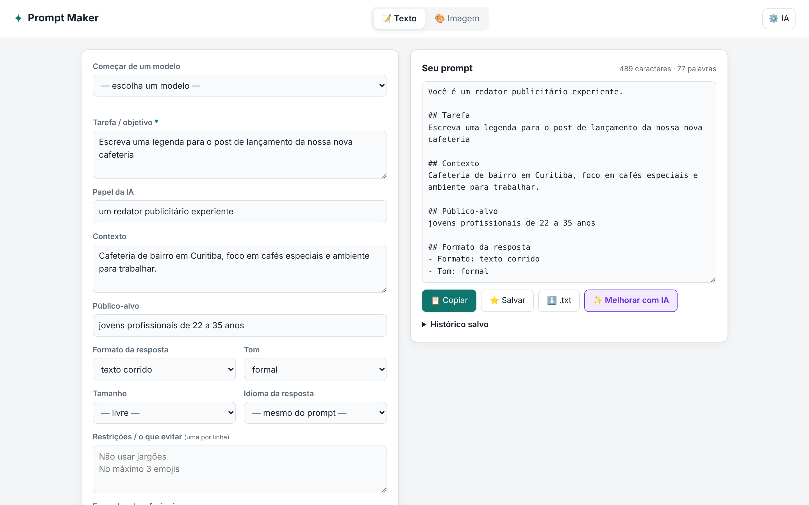
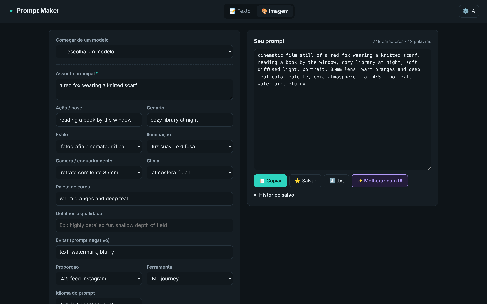
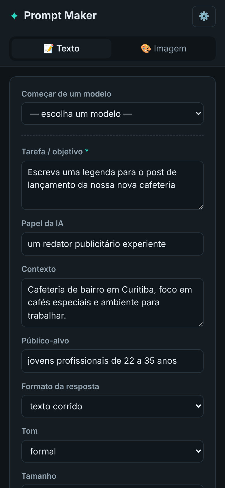

<div align="center">

# ✦ Prompt Maker

**Monte prompts profissionais para IAs de texto e de imagem em segundos — e deixe o Claude lapidar o resultado.**

[](https://jocaeromero.github.io/prompt-maker/)
[](https://github.com/jocaeromero/prompt-maker/actions/workflows/pages.yml)
[](LICENSE)


-F7DF1E?style=flat-square&logo=javascript&logoColor=black)


<br>



</div>

---

## 💡 O problema

Prompt bom tem estrutura: papel, tarefa, contexto, público, formato, restrições e exemplos. Escrever isso do zero toda vez é lento, e cada ferramenta de imagem espera uma sintaxe diferente (`--ar` no Midjourney, `Negative prompt:` no Stable Diffusion…).

O **Prompt Maker** transforma um formulário simples em um prompt pronto para colar, no formato certo para cada IA — e, com um clique, manda o rascunho para o **Claude** reescrever em streaming.

## ✨ Funcionalidades

| | |
|---|---|
| 📝 **Prompts de texto** | Papel, tarefa, contexto, público, formato, tom, tamanho, idioma, restrições e exemplos. Saída em **Markdown**, **tags XML** (recomendado para o Claude) ou texto simples, em português ou inglês. |
| 🎨 **Prompts de imagem** | Assunto, ação, cenário, estilo, luz, câmera, clima, paleta e prompt negativo. Formata automaticamente para **Midjourney**, **DALL·E / GPT Image** e **Stable Diffusion / Flux**, traduzindo as opções para o inglês. |
| ✨ **Melhorar com IA** | Envia o rascunho para a API do Claude e mostra a versão melhorada **em tempo real (streaming)**, com botão para parar. |
| ⚡ **Modelos prontos** | Post para redes sociais, e-mail, revisão de código, foto de produto, retrato cinematográfico… |
| ⭐ **Histórico e exportação** | Copiar, salvar no histórico (até 50 itens) e baixar `.txt`. Formulário e histórico persistem no navegador. |
| 🌗 **Tema claro/escuro e mobile** | Segue o tema do sistema e funciona bem em telas pequenas. |

<div align="center">

&nbsp;

</div>

## 🛠️ Decisões técnicas

- **Zero build, zero dependências.** HTML, CSS e JavaScript puros com ES Modules. Abre em qualquer hospedagem estática.
- **SDK carregado sob demanda.** O SDK da Anthropic só é importado (via CDN, com versão fixa) quando o usuário clica em *Melhorar com IA*, então a carga inicial continua leve.
- **Streaming com cancelamento.** A resposta do Claude aparece token a token, e o botão *Parar* interrompe a requisição.
- **Acessibilidade.** Labels ligados a cada campo, `role="tablist"`/`aria-selected` nas abas, `aria-live` nas notificações e foco visível.
- **Tema por design tokens.** Cores em variáveis CSS, redefinidas para o modo escuro com `prefers-color-scheme`.
- **Privacidade.** A chave de API fica só no `localStorage` de quem usa e vai direto para a API da Anthropic, sem servidor intermediário.
- **CI/CD.** Cada push na `master` publica o site no GitHub Pages via GitHub Actions.

## 🚀 Rodando localmente

```bash
git clone https://github.com/jocaeromero/prompt-maker.git
cd prompt-maker
python3 -m http.server 8000
# abra http://localhost:8000
```

> Abrir o `index.html` com duplo clique não funciona, porque o navegador bloqueia módulos JS em `file://`.

Para usar o **✨ Melhorar com IA**, clique em **⚙️ IA** e cole sua chave de API da Anthropic ([console.anthropic.com](https://console.anthropic.com/settings/keys)).

> 🔒 Use uma chave só sua e evite computadores compartilhados. Para liberar o recurso a outras pessoas usando a sua chave, o caminho certo é mover a chamada para um backend (por exemplo, uma função serverless).

## 📁 Estrutura

```
.
├── index.html          # estrutura da página e formulários
├── styles.css          # visual, design tokens e modo escuro
├── app.js              # opções, modelos, montagem dos prompts e integração com o Claude
├── docs/               # screenshots do README
└── .github/workflows/  # deploy automático no GitHub Pages
```

## 🗺️ Próximos passos

- [ ] Backend serverless para usar o *Melhorar com IA* sem chave própria
- [ ] Compartilhar prompt por link
- [ ] Mais modelos prontos e ferramentas de imagem
- [ ] Testes automatizados da montagem dos prompts

---

<details>
<summary>🇺🇸 <b>English summary</b></summary>

<br>

**Prompt Maker** is a zero-dependency web app that turns a simple form into well-structured prompts for text AIs (Claude, ChatGPT…) and image AIs (Midjourney, DALL·E, Stable Diffusion, Flux). It formats output for each tool's syntax, ships ready-made templates, keeps a local history, and can send the draft to the **Claude API** to rewrite it with **real-time streaming**.

Built with vanilla HTML, CSS and JavaScript (ES Modules), light/dark themes, accessible markup, and continuous deployment to GitHub Pages.

**[▶ Live demo](https://jocaeromero.github.io/prompt-maker/)**

</details>

<div align="center">

Feito por [@jocaeromero](https://github.com/jocaeromero) · Licença [MIT](LICENSE)

</div>
